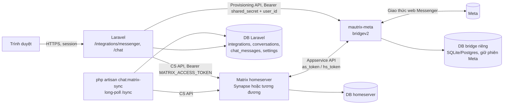
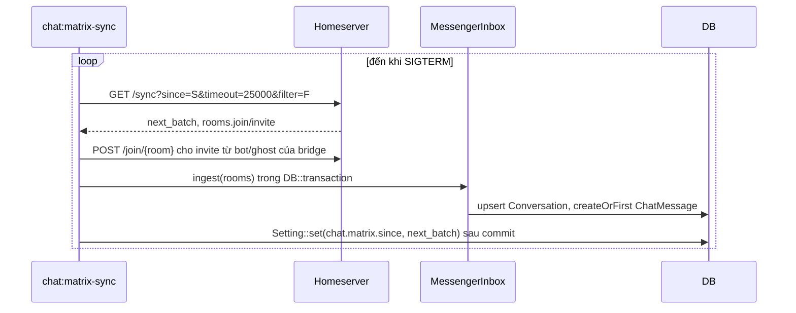

# Thiết kế: kênh Messenger cá nhân trong /chat qua mautrix-meta

Trạng thái: **thiết kế, chưa có code, chưa chạy thử hạ tầng**. Ngày: 2026-10-31.

Input chính: [`docs/plans/meta-messenger-instagram-mautrix-20261027.json`](../plans/meta-messenger-instagram-mautrix-20261027.json) (gọi tắt là _plan khảo sát_). Tài liệu này chỉ lấy phần Messenger, bỏ Instagram DM, và chốt lại một số điểm của plan khảo sát cho phạm vi hẹp hơn (xem mục 2.4 "Khác với plan khảo sát").

Quy ước nhãn trong tài liệu:

- **[Đã xác minh]**: đọc trong code repo (có đường dẫn) hoặc đã được plan khảo sát xác minh từ nguồn chính thức (mautrix/meta, docs.mau.fi, mautrix/go) ngày 2026-10-27.
- **[Giả định]**: chưa xác minh, cần spike (TASK-001 của plan khảo sát) để xác nhận.
- **[Đề xuất]**: quyết định thiết kế của tài liệu này.

---

## 1. Bài toán và phạm vi

### 1.1 Mục tiêu

Trong `/chat` có thêm kênh **Messenger cá nhân**: thấy danh sách hội thoại, nhận tin mới, trả lời tin từ composer. Đăng nhập và ngắt kết nối làm ở trang Tích hợp, bằng cách người dùng **tự dán cookie facebook.com** (datr, c_user, sb, xs...) vào form. Không tự viết bridge: dùng **mautrix-meta** (Go, AGPL-3.0, bridgev2) chạy sau một Matrix homeserver nội bộ.

### 1.2 Actor

| Actor                                                   | Vai trò                                                               |
| ------------------------------------------------------- | --------------------------------------------------------------------- |
| Chủ app (người dùng có quyền `integrations.update`)     | Dán cookie, đăng nhập/ngắt kết nối, kiểm tra kết nối                  |
| Nhân viên (`conversations.view`, `conversations.reply`) | Đọc và trả lời tin trong `/chat`                                      |
| Người nhắn trên Messenger                               | Gửi tin tới tài khoản Facebook đã kết nối                             |
| Laravel (Matrix user riêng, vd `@pm:<server_name>`)     | Matrix client duy nhất điều khiển bridge                              |
| mautrix-meta                                            | Giữ phiên Meta, chuyển tin Messenger <-> Matrix                       |
| Matrix homeserver                                       | Nơi bridge tạo portal room; Laravel đọc/gửi tin qua Client-Server API |

### 1.3 Trong phạm vi

- Provider tích hợp mới `messenger`, form dán cookie, đăng nhập qua Provisioning API, kiểm tra kết nối, ngắt kết nối.
- Nhận tin văn bản (và nhãn "Loại tin chưa hỗ trợ" cho media), đồng bộ danh sách hội thoại từ portal room.
- Trả lời văn bản trong hội thoại đã có, theo contract `ChatSender`.
- Đăng ký kênh trong registry `/chat`, badge kênh, banner mất kết nối dùng cơ chế sẵn có.
- Runbook vận hành homeserver + mautrix-meta + vòng đồng bộ.

### 1.4 Ngoài phạm vi (giai đoạn này)

- **Đăng bài** (Fanpage/cá nhân). Đăng Fanpage hiện có bằng token chính thức giữ nguyên.
- **Instagram DM** (mautrix-instagram là tiến trình khác; thiết kế để lớp Matrix tái dùng được nhưng không triển khai).
- **Sửa mã nguồn bridge** hoặc fork bridge.
- App **tự lấy cookie** hộ người dùng dưới bất kỳ hình thức nào: không script tiêm/trích cookie, không browser automation, không webview, không chạy `extract_js` mà bridge có thể trả về trong bước `cookies`.
- Đăng nhập bằng username/password (flow `messenger-lite*`), đăng nhập cookie messenger.com (flow `messenger`).
- Tạo hội thoại mới, gửi chủ động hàng loạt, bot/AI tự trả lời.
- Gửi media, reaction, sửa/thu hồi, typing, read receipt ra Meta; xem ảnh trong /chat; backfill lịch sử.
- Đóng gói NativePHP Desktop (plan `nativephp-desktop-20261027.json` có status `CANCELLED` [Đã xác minh]).

### 1.5 Ràng buộc

- Stack thật [Đã xác minh]: Laravel 13 (`composer.json` `laravel/framework ^13.17`), Inertia v3 + React/TypeScript, Wayfinder route; DB mặc định SQLite (`composer.json` script tạo `database/database.sqlite`); broadcast Pusher tuỳ chọn (`.env.example`).
- Pattern kênh không chính thức có sẵn: Zalo qua sidecar Node `zalo-bridge/` (HTTP loopback, HMAC hai chiều), registry `app/Services/Chat/ChatChannels.php`, contract `app/Services/Chat/ChatSender.php`.
- mautrix-meta **không có chế độ standalone**: bắt buộc homeserver hỗ trợ application service [Đã xác minh, plan khảo sát research.verified].
- Binary release chỉ có linux amd64/arm/arm64 và darwin-arm64 [Đã xác minh]; không có Windows, macOS Intel.

### 1.6 Yêu cầu phi chức năng (giả định có nhãn)

Không có số liệu đo; các con số dưới là **[Giả định]** cho app cá nhân tự host, một chủ tài khoản:

| Chỉ số                          | Giả định                                                    | Ảnh hưởng thiết kế                                               |
| ------------------------------- | ----------------------------------------------------------- | ---------------------------------------------------------------- |
| Số tài khoản Messenger          | 1 (một login trên bridge)                                   | `integrations.provider` unique là đủ                             |
| Lưu lượng tin                   | < 1 tin/giây đỉnh, vài trăm tin/ngày                        | Một tiến trình long-poll `/sync` là đủ, không cần queue          |
| Số hội thoại                    | vài trăm tới vài nghìn                                      | Upsert theo `(provider, external_chat_id)` đã có unique          |
| Độ trễ nhận tin (Meta -> /chat) | mục tiêu p95 < 10 giây khi mọi tiến trình chạy              | Long-poll 25 giây, không dùng scheduler 1 phút làm chế độ chính  |
| Availability                    | best effort, không SLA                                      | Tiến trình chết thì tin trễ, bridge tự catchup khi khởi động lại |
| RPO/RTO                         | không cam kết; mất phiên Meta thì người dùng dán cookie lại | Không cần backup phiên ở phía Laravel                            |

### 1.7 Bảng yêu cầu

| ID  | Yêu cầu                                    | Ưu tiên | Tiêu chí chấp nhận                                                                                                                                                                                                                                      | Thành phần đáp ứng                                                          |
| --- | ------------------------------------------ | ------- | ------------------------------------------------------------------------------------------------------------------------------------------------------------------------------------------------------------------------------------------------------- | --------------------------------------------------------------------------- |
| R1  | Đăng nhập bằng cookie facebook.com dán tay | P0      | Chưa tick rủi ro -> 422, không gọi bridge. Thiếu `c_user`/`xs` (hoặc cookie bắt buộc khác bridge yêu cầu) -> 422 trước khi gọi bridge. Cookie đúng -> Integration `messenger` = `connected`, `meta.login_id`, `meta.account_name`; `credentials` = null | `MessengerLoginController`, `BridgeProvisioningClient`, `MessengerChannel`  |
| R2  | Không lưu/log cookie                       | P0      | Grep log sau test không thấy giá trị cookie; `integrations.credentials` của `messenger` null; props/JSON trả client không chứa cookie, token Matrix, provisioning secret, login process id                                                              | Controller, client HTTP, request validation                                 |
| R3  | Kiểm tra kết nối và ngắt kết nối           | P0      | "Kiểm tra kết nối" gọi bridge `GET /v3/logins`, ánh xạ state -> status/last_error chữ cố định. "Ngắt kết nối" gọi `POST /v3/logout/{loginID}`, status `disconnected`, chat cũ giữ nguyên; ngắt được cả khi bridge không chạy                            | `ConfiguredIntegrationProvider` (nhánh `matrix_bridge`), `MessengerChannel` |
| R4  | Nhận tin mới vào /chat                     | P0      | `m.room.message` `m.text` từ người khác trong portal room -> `ChatMessage` in, `external_message_id = event_id`; unread +1; preview cập nhật; chạy lại batch không tạo trùng                                                                            | `chat:matrix-sync`, `MessengerInbox`                                        |
| R5  | Danh sách hội thoại sau đăng nhập          | P1      | Portal room đã join -> `Conversation` (title, type), không tạo `ChatMessage` từ lịch sử; tên rỗng không ghi đè                                                                                                                                          | `MessengerInbox::ingestRoom`                                                |
| R6  | Trả lời tin theo ChatSender                | P0      | Một request `PUT .../send/m.room.message/{txnId}`; double submit cùng `client_token` -> 1 request, 1 bản ghi; timeout/5xx -> `unknown`; 4xx -> `failed`; resend thủ công, chiếm bằng UPDATE nguyên tử                                                   | `MessengerSender`                                                           |
| R7  | Cảnh báo rủi ro tài khoản                  | P0      | Trang hiện cảnh báo khoá/checkpoint; bắt buộc tick "Tôi hiểu rủi ro" trước khi đăng nhập                                                                                                                                                                | `config/integrations.php` (`unofficial`), controller                        |
| R8  | Hiện trong /chat                           | P0      | `channels.messenger` có trong props `/chat`, badge kênh, banner + khoá composer khi `error`/`disconnected`                                                                                                                                              | `ChatChannels`, `channel-badge.tsx`, `AppServiceProvider`                   |
| R9  | Vận hành tái lập được                      | P1      | Runbook đủ để dựng lại trên máy sạch tới bước `GET /v3/whoami` 200; `.env.example` có biến rỗng                                                                                                                                                         | `docs/repo/` runbook, `config/services.php`                                 |
| R10 | Media nhận về không làm vỡ luồng           | P2      | `m.image/m.video/m.audio/m.file/m.sticker` -> body "Loại tin chưa hỗ trợ: <loại>", không tải media                                                                                                                                                      | `MessengerInbox`                                                            |

---

## 2. Kiến trúc tổng thể (HLD)

### 2.1 Thành phần và đường đi request



Tất cả bind `127.0.0.1`, federation tắt. Trust boundary: (1) trình duyệt <-> Laravel (auth + quyền như hiện có); (2) Laravel <-> homeserver/bridge chỉ qua loopback với secret trong `.env`; (3) bridge <-> Meta là ranh giới bên ngoài, ngoài tầm kiểm soát.

| Thành phần                                             | Trách nhiệm                                                                                     | Nguồn dữ liệu chuẩn                                                     |
| ------------------------------------------------------ | ----------------------------------------------------------------------------------------------- | ----------------------------------------------------------------------- |
| mautrix-meta (binary/image chính thức, ghim phiên bản) | Giữ phiên Meta, tạo portal room, chuyển tin hai chiều, báo trạng thái login                     | Phiên Meta, ánh xạ thread <-> room (DB bridge)                          |
| Homeserver                                             | Lưu room/event, idempotency `txnId`, phân phối event qua `/sync`                                | Event Matrix                                                            |
| Laravel `app/Services/Chat/Matrix/*`                       | Client HTTP cho CS API và Provisioning API, không retry, không log body                         | Không giữ trạng thái                                                    |
| Laravel `app/Services/Chat/Messenger/*`                    | Quy tắc kênh: trạng thái, quyền, ánh xạ room/event -> Conversation/ChatMessage, gửi tin         | `integrations` (provider `messenger`), `conversations`, `chat_messages` |
| `chat:matrix-sync`                                     | Vòng long-poll `/sync`, lưu `since`, auto-join invite của bridge, kiểm trạng thái login định kỳ | `settings` khoá `chat.matrix.since`                                     |

Giao tiếp: tất cả **đồng bộ HTTP, chiều Laravel gọi ra** (pull). Không có callback mới vào Laravel, nên không cần route `/internal/*` hay HMAC chiều vào như Zalo.

### 2.2 Có cần Synapse không

**Bắt buộc có một Matrix homeserver hỗ trợ application service; mautrix-meta không chạy standalone** [Đã xác minh: docs.mau.fi setup "A Matrix homeserver that supports application services (e.g. Synapse)"; option `homeserver.websocket` chỉ dành cho wsproxy/hungryserv, không phải chế độ không homeserver].

| Phương án               | Điều kiện áp dụng                                               | Lợi ích                                                  | Chi phí vận hành                                                               | Rủi ro                                                      |
| ----------------------- | --------------------------------------------------------------- | -------------------------------------------------------- | ------------------------------------------------------------------------------ | ----------------------------------------------------------- |
| **A. Synapse**          | Muốn homeserver tham chiếu, được docs mautrix hỗ trợ chính thức | Chuẩn nhất, nhiều tài liệu, bridge test chủ yếu trên đây | Python, nặng hơn; khuyến nghị Postgres; trên macOS dev thường chạy bằng Docker | RAM/đĩa cao hơn (chưa đo)                                   |
| B. continuwuity/Conduit | Muốn nhẹ, một binary, DB nhúng                                  | Nhẹ, cài nhanh                                           | Ít phổ biến; đăng ký appservice bằng lệnh admin                                | docs mau.fi chỉ ghi "also fine"; binary macOS chưa xác minh |
| C. Beeper (hosted)      | Không muốn tự host                                              | Không vận hành                                           | Dữ liệu tin qua bên thứ ba, homeserver không chuẩn                             | Loại vì quyền riêng tư                                      |

Không dùng Dendrite ("not a supported environment" theo docs mautrix).

**[Đề xuất] Chọn A (Synapse)** làm mặc định vì đây là môi trường được hỗ trợ rõ ràng và giảm biến số khi debug bridge; B là phương án dự phòng nếu tài nguyên máy là vấn đề. Quyết định cuối nằm ở câu hỏi mở Q1. Xem lại quyết định khi: đo RAM thực tế ở spike vượt ngưỡng chấp nhận, hoặc Synapse gây khó cài trên máy dev.

### 2.3 Quyết định kiến trúc chính

**QĐ1. Laravel là Matrix client (pull `/sync`), không đăng ký làm appservice thứ hai.**

- Lựa chọn khác: Laravel làm appservice để homeserver đẩy transaction qua HTTP. Bỏ vì phải mở thêm endpoint callback + `hs_token`, sửa config homeserver thêm lần nữa; long-poll giống `chat:telegram-poll` (`app/Console/Commands/TelegramPollCommand.php`) đơn giản và đã có mẫu.
- Xem lại khi: cần độ trễ thấp hơn long-poll hoặc nhiều tài khoản.

**QĐ2. Provider mới `messenger`, không tái dùng `facebook`.** Lý do [Đã xác minh trong code]:

1. `integrations.provider` là unique (`database/migrations/2026_10_27_000002_create_integrations_table.php`): một bản ghi chỉ có một `status`. `facebook` đang là kết nối Fanpage chính thức (`test = facebook`, `active = true`); gộp vào sẽ làm trạng thái Fanpage và Messenger cá nhân đè nhau.
2. `ConfiguredIntegrationProvider::disconnect()` đặt `credentials = null` và `meta = null` cho cả bản ghi: ngắt Messenger cá nhân trên `facebook` sẽ xoá luôn Page access token.
3. `ChatChannels` ánh xạ theo `conversation.provider`; chat dùng provider riêng (`telegram`, `zalo`) là quy ước có sẵn.
4. Route `integrations/{provider}` có ràng buộc `[a-z]+` (`routes/web.php`): `messenger` khớp, không cần sửa ràng buộc.
5. `UpdateIntegrationRequest::requiresRiskAcknowledgement()` bắt tick rủi ro khi provider có `unofficial = true`: provider riêng cho Messenger cá nhân dùng nguyên cơ chế này, không phụ thuộc field nào được điền.

**QĐ3. Laravel không lưu cookie Meta; phiên do bridge giữ.** Cookie chỉ đi qua Laravel trong một request đăng nhập rồi chuyển thẳng cho bridge. Khác Zalo (Laravel giữ phiên mã hoá, `ZaloBridgeController::storeSession`) vì bridgev2 tự lưu phiên trong DB của nó và không có API nhận lại phiên. Khi phiên hết hạn (`BAD_CREDENTIALS`) cookie cũ cũng vô dụng, nên lưu bản sao không có giá trị phục hồi mà chỉ tăng bề mặt lộ.

**QĐ4. Field `facebook.messenger_token` (secret) và `facebook.messenger_account` không dùng cho kênh mới; đề xuất gỡ.** [Đã xác minh] `config/integrations.php` có `messenger_token` (secret, "Chuỗi cookie phiên (datr, c_user, xs...)"), `messenger_account` (text) và quyền `personal_messenger`; không có runtime nào đọc chúng (grep `app/`, `resources/js/` chỉ thấy config; test `tests/Feature/Integrations/FacebookTokenLoginTest.php::test_messenger_token_requires_risk_acknowledgement` xác nhận cookie được **lưu mã hoá trong `integrations.credentials`**). Giữ lại sẽ:

- tạo một nơi thứ hai lưu cookie Meta, trái QĐ3;
- gây nhầm cho người dùng (dán cookie ở thẻ Facebook nhưng kênh không chạy).

[Đề xuất] Trong task triển khai: gỡ hai field + quyền `personal_messenger` khỏi `facebook`, sửa mô tả `facebook` thành chỉ Fanpage, cập nhật/bỏ test tương ứng. Giá trị `messenger_token` đã lưu trong DB (nếu có) **không tự động bị xoá** vì `connect()` merge credentials: việc xoá là ghi dữ liệu thật, cần người dùng duyệt riêng (Q3). Không chuyển cookie đã lưu sang bridge: người dùng dán lại ở trang mới (đồng ý rõ ràng, cookie mới).

**QĐ5. Đăng nhập một request đồng bộ, chỉ flow `facebook`.** Vì chỉ cho phép flow cookie facebook.com, server gói `start` + `step(cookies)` + chờ `complete` trong một request; không giữ login process id qua nhiều request, không cần dialog nhiều bước như plan khảo sát. Bước khác ngoài kỳ vọng (`user_input` cho 2FA/checkpoint, `webauthn`, `client_http`, `display_and_wait` quá lâu) -> huỷ process, báo chữ cố định.

**QĐ6. `external_chat_id` = Matrix room_id của portal; không migration.** Bảng hiện có đủ cột (mục 3). Đánh đổi: nếu bridge tái tạo portal (reset DB bridge) sẽ sinh hội thoại mới. Phương án thay thế (dùng Meta thread id từ state `m.bridge`) cần thêm ánh xạ room để gửi và chưa xác minh payload; xem lại sau spike.

**QĐ7. Không sửa source bridge; chạy release chính thức ghim phiên bản** (mục 5.4).

### 2.4 Khác với plan khảo sát

| Điểm                              | Plan khảo sát                                                          | Tài liệu này                                          | Lý do                                                                            |
| --------------------------------- | ---------------------------------------------------------------------- | ----------------------------------------------------- | -------------------------------------------------------------------------------- |
| Phạm vi                           | Messenger + Instagram DM                                               | Chỉ Messenger                                         | Yêu cầu giai đoạn này                                                            |
| Homeserver mặc định               | continuwuity (A4)                                                      | Synapse, continuwuity dự phòng                        | Người giao việc nêu Synapse; môi trường được hỗ trợ rõ nhất                      |
| Luồng đăng nhập                   | Dialog nhiều bước, chọn flow từ `GET /v3/login/flows`, có thể password | Một form dán cookie, chỉ flow `facebook`, một request | Người dùng chốt cookie facebook.com                                              |
| Lớp kênh                          | `MetaChannel` tham số hoá provider                                     | `MessengerChannel` riêng; lớp `Matrix/*` dùng chung   | Không trừu tượng trước cho Instagram (YAGNI); lớp Matrix vốn là client giao thức |
| `login` key trong config          | `meta`                                                                 | `matrix_bridge`                                       | Mô tả đúng cơ chế, tách khỏi thương hiệu                                         |
| Resend tin `failed` do bridge báo | Dùng lại cùng txnId                                                    | txnId mới có tất định (mục 3.6)                       | Cùng txnId thì homeserver trả lại event cũ, bridge không gửi lại                 |
| Field cũ của `facebook`           | Giữ nguyên (Q7 mở)                                                     | Đề xuất gỡ (QĐ4)                                      | Có thêm `messenger_token` lưu cookie, trái QĐ3                                   |

---

## 3. Dữ liệu và API (LLD)

### 3.1 Dữ liệu: dùng lại bảng hiện có, không migration

[Đã xác minh] Bảng và ràng buộc hiện có:

- `integrations`: `provider` unique, `status` enum `connected|error|disconnected`, `credentials` encrypted, `settings` json, `meta` json, `last_checked_at`, `last_error`.
- `conversations`: `provider` string (không enum), unique `(provider, external_chat_id)`, `integration_id` nullable FK, `type` `private|group`, `title`, `unread_count`, cột preview.
- `chat_messages`: unique `(conversation_id, external_message_id)` và `(conversation_id, client_token)`, `client_token` varchar(64), `send_status` `sending|sent|unknown|failed`, `error` text.
- `settings`: `Setting::get/set` (`app/Models/Setting.php`).

Ánh xạ [Đề xuất]:

| Đối tượng                              | Trường                          | Giá trị                                                                                                                                                 |
| -------------------------------------- | ------------------------------- | ------------------------------------------------------------------------------------------------------------------------------------------------------- |
| `Integration` (`provider = messenger`) | `credentials`                   | luôn `null`                                                                                                                                             |
|                                        | `settings.fields`               | `group_mode` (`all`\|`off`)                                                                                                                             |
|                                        | `settings.permissions`          | `receive`, `reply`, `proactive` (proactive mặc định tắt)                                                                                                |
|                                        | `settings.risk_acknowledged`    | `true` sau khi tick                                                                                                                                     |
|                                        | `meta`                          | `login_id`, `account_name`, `remote_id` (Facebook user id nếu bridge trả), `connected_at`, `bridge_state`, `bridge_state_at`, `conversations_synced_at` |
| `Conversation`                         | `provider` / `external_chat_id` | `messenger` / Matrix room_id (`!abc:server`)                                                                                                            |
|                                        | `type`                          | `private`\|`group` (tín hiệu xác minh ở spike; tạm theo số thành viên joined > 2 trừ bot)                                                               |
|                                        | `title`                         | `m.room.name`, nếu rỗng thì displayname thành viên còn lại; không ghi đè bằng rỗng                                                                      |
|                                        | `integration_id`                | id Integration `messenger`                                                                                                                              |
| `ChatMessage` in                       | `external_message_id`           | Matrix `event_id`                                                                                                                                       |
|                                        | `sender_type` / `sender_name`   | `customer` / displayname người gửi                                                                                                                      |
|                                        | `body`                          | text, hoặc "Loại tin chưa hỗ trợ: ảnh\|video\|tin nhắn thoại\|tệp\|sticker"                                                                             |
| `ChatMessage` out                      | `client_token`                  | token từ composer (như hiện có)                                                                                                                         |
|                                        | `external_message_id`           | `event_id` homeserver trả khi gửi thành công                                                                                                            |
| `settings`                             | `chat.matrix.since`             | `next_batch` của `/sync`, ghi sau khi transaction của batch commit                                                                                      |

Vòng đời: ngắt kết nối không xoá `conversations`/`chat_messages` (giống Zalo). Rollback tính năng: đặt `active = false`, dừng tiến trình; xoá `chat.matrix.since` nếu muốn sync lại từ đầu.

Index: truy vấn chính là upsert theo unique đã có và danh sách hội thoại theo `last_message_at` (đã có index). Không cần index mới.

### 3.2 Cấu hình provider [Đề xuất]

Thêm vào `config/integrations.php`, nhóm `messaging`, theo mẫu `zalo`:

- `name` "Messenger cá nhân", `letter` "M", `color` theo thương hiệu Messenger (chốt lúc làm, cùng giá trị ở badge), `unofficial: true`, `login: 'matrix_bridge'`, `test: 'matrix_bridge'`, `active: false` cho tới khi nhận/gửi đã test.
- `fields`: `group_mode` (select `all` "Nhận và trả lời trong nhóm", `off` "Không trả lời trong nhóm"). Không có field secret.
- `permissions`: `receive`, `reply`, `proactive` (default false, mô tả "Tắt để giảm rủi ro khoá tài khoản").
- `steps` (chữ hướng dẫn, người dùng tự làm): mở facebook.com trong trình duyệt của bạn và đăng nhập; mở Công cụ cho nhà phát triển > Application/Storage > Cookies > `https://www.facebook.com`; sao chép giá trị `c_user`, `xs`, `datr`, `sb` (và cookie khác nếu form yêu cầu) thành chuỗi `tên=giá_trị; tên=giá_trị`; dán vào ô, tick rủi ro, bấm Đăng nhập; không bấm Đăng xuất trên trình duyệt đó (đăng xuất làm cookie mất hiệu lực, cần xác minh với docs authentication ở spike).
- Cập nhật chú thích đầu file: `login = matrix_bridge` nghĩa là đăng nhập qua Provisioning API của bridge, form không tự đặt `connected`.

`ConfiguredIntegrationProvider` [Đề xuất]: tổng quát `usesQrLogin()` thành "đăng nhập do bridge quản lý" cho cả `qr` và `matrix_bridge` để `connect()` (lưu form) không tự đặt `connected`; `disconnect()` gọi logout của bridge tương ứng (best effort như `logoutBridge()` của Zalo); `test()` thêm nhánh `matrix_bridge`.

### 3.3 Biến môi trường và `config/services.php` [Đề xuất]

Khối `services.matrix` đọc env (giá trị rỗng trong `.env.example`, không commit):

| Biến                               | Ví dụ                    | Ý nghĩa                                                                            |
| ---------------------------------- | ------------------------ | ---------------------------------------------------------------------------------- |
| `MATRIX_HOMESERVER_URL`            | `http://127.0.0.1:8008`  | CS API của homeserver                                                              |
| `MATRIX_USER_ID`                   | `@pm:pm.local`           | Matrix user của Laravel                                                            |
| `MATRIX_ACCESS_TOKEN`              | (secret)                 | Token của user trên                                                                |
| `MAUTRIX_META_PROVISIONING_URL`    | `http://127.0.0.1:29319` | Listener appservice của bridge (prefix `/_matrix/provision`)                       |
| `MAUTRIX_META_PROVISIONING_SECRET` | (secret, >= 16 ký tự)    | `provisioning.shared_secret` trong config bridge                                   |
| `MAUTRIX_META_BOT_USER_ID`         | `@metabot:pm.local`      | Bot của bridge, để phân loại portal room (tên thật xác minh ở spike)               |
| `MAUTRIX_META_GHOST_PREFIX`        | `@meta_`                 | Tiền tố ghost theo `username_template`, để nhận diện tin tự gửi (xác minh ở spike) |
| `MAUTRIX_META_SEND_PER_MINUTE`     | `10`                     | Giới hạn gửi giống `ZALO_BRIDGE_SEND_PER_MINUTE`                                   |

Thiếu URL/secret/token -> client ném exception "not configured" trước khi gọi mạng; trang Tích hợp báo "Chưa cấu hình Messenger bridge"; `chat:matrix-sync` ngủ và thử lại, không gọi mạng.

### 3.4 Route và contract HTTP phía Laravel [Đề xuất]

Đặt trong nhóm `integrations` trước `{provider}` (giống `zalo/qr`), quyền `integrations.update`:

| Method/path                         | Middleware                                               | Input                                                       | Output                                                       | Lỗi                                                                                                                                                                      |
| ----------------------------------- | -------------------------------------------------------- | ----------------------------------------------------------- | ------------------------------------------------------------ | ------------------------------------------------------------------------------------------------------------------------------------------------------------------------ |
| `POST integrations/messenger/login` | `AuthorizeResource:integrations,update`, `throttle:5,10` | JSON `{risk_acknowledged: true, cookies: string}` (<= 8 KB) | 200 `{status: 'connected', account_name}`, header `no-store` | 422 thiếu tick / cookie sai định dạng / thiếu cookie bắt buộc / bước không hỗ trợ; 503 bridge không chạy hoặc chưa cấu hình; 502 bridge lỗi; 409 đang có login khác chạy |
| `POST integrations/{provider}/test` | có sẵn                                                   | -                                                           | `ConnectionTestResult` như hiện có                           | chữ cố định                                                                                                                                                              |
| `DELETE integrations/{provider}`    | có sẵn                                                   | -                                                           | redirect như hiện có                                         | ngắt được cả khi bridge chết                                                                                                                                             |

Không có route mới cho `/chat` (gửi/resend dùng route sẵn có `chat.send`, `chat.resend`). Frontend dùng route Wayfinder sinh tự động, không sửa tay.

Request đăng nhập gửi bằng JSON fetch (như `zalo-qr-dialog.tsx`), không qua Inertia form, để input không bị flash vào session. Thêm `cookies` vào danh sách `dontFlash` của exception handler (`bootstrap/app.php`) phòng trường hợp validation redirect.

### 3.5 Luồng đăng nhập (mục 2 của yêu cầu)

```mermaid
sequenceDiagram
    participant U as Trình duyệt
    participant L as Laravel MessengerLoginController
    participant P as mautrix-meta Provisioning API
    U->>L: POST /integrations/messenger/login {risk_acknowledged, cookies}
    L->>L: validate tick + parse cookie + lock "messenger-login"
    L->>P: GET /v3/logins?user_id=@pm (đã có login?)
    alt đã có login
        L->>P: POST /v3/logout/{loginID}
    end
    L->>P: POST /v3/login/start/facebook
    P-->>L: step type=cookies (fields: datr, c_user, sb, xs...)
    L->>L: kiểm cookie bắt buộc theo fields; bỏ qua extract_js/url
    L->>P: POST /v3/login/step/{process}/{step}/cookies {cookie map}
    P-->>L: step type=complete (login id, profile) hoặc display_and_wait/lỗi
    alt complete
        L->>L: Integration messenger = connected, meta.login_id, account_name, credentials null
        L-->>U: 200 connected
        L->>L: sau response: SyncMessengerConversationsJob (sync một lần)
    else bước khác / lỗi
        L->>P: POST /v3/login/cancel/{process}
        L-->>U: 422/502 chữ cố định
    end
```

Chi tiết [Đề xuất]:

1. **Kiểm trước khi gọi mạng (fail fast)**: `risk_acknowledged` accepted; `cookies` string <= 8 KB. Parse hai dạng: chuỗi header `name=value; name=value` và JSON object `{name: value}`. Tên cookie chỉ `[A-Za-z0-9_.-]`, giá trị không chứa `;`, CR/LF. Thiếu `c_user` hoặc `xs` -> 422 ngay.
2. **Cookie bắt buộc theo bridge**: sau `start`, so tập cookie đã dán với `fields` bước `cookies` mà bridge trả (field `required`). Chỉ gửi đi những tên bridge khai báo (allowlist), bỏ phần còn lại. Payload thật của bước này chưa xác minh (plan khảo sát notVerified) -> ghi lại ở spike.
3. **Không chạy gì từ bridge phía client**: nếu bước `cookies` có `extract_js`, `url`, `user_agent` hay tương tự (dành cho webview của mautrix-manager), Laravel bỏ qua; không gửi chúng xuống trình duyệt.
4. **Bước không mong đợi**: `user_input` (2FA/checkpoint), `webauthn`, `client_http` -> huỷ process, 422 "Facebook yêu cầu xác minh thêm. Hãy mở facebook.com trên trình duyệt, hoàn tất xác minh rồi dán lại cookie mới." / "Cách đăng nhập này chưa hỗ trợ". `display_and_wait` -> gọi tiếp tối đa N lần trong tổng thời gian <= 30 giây, quá thì huỷ và báo thử lại.
5. **Đồng thời**: cache lock `messenger-login` (TTL 60 giây) chặn hai lần đăng nhập song song -> 409.
6. **Lưu**: chỉ khi `complete`: `forceFill` `status = connected`, `last_error = null`, `last_checked_at`, `meta.login_id/account_name/remote_id/connected_at`, `settings.permissions` mặc định nếu chưa có, `settings.risk_acknowledged = true`, `credentials = null`.
7. **Không log**: không đưa input vào exception context, không log body request/response, lỗi bridge chuyển thành chữ cố định (mẫu `ZaloBridgeException`).
8. **Bridge config** liên quan: `provisioning.shared_secret`, `bridge.permissions` chỉ cho `MATRIX_USER_ID` (mức `admin` hoặc `user`, chốt ở spike), `*` không quyền.

### 3.6 Client HTTP [Đề xuất]

`app/Services/Chat/Matrix/MatrixClient` (CS API) và `BridgeProvisioningClient` (Provisioning API bridgev2), theo mẫu `ZaloBridgeClient`: `Http` facade, `connectTimeout` 1 giây, không retry, không log body, không đưa message của `ConnectionException` ra UI/log, parse phòng thủ (sai kiểu -> exception 502). Exception riêng `MatrixException(status, errcode)` không chứa body.

| Client                                                 | Method                            | Endpoint                                                            | Timeout          |
| ------------------------------------------------------ | --------------------------------- | ------------------------------------------------------------------- | ---------------- |
| Matrix                                                 | `whoami()`                        | `GET /_matrix/client/v3/account/whoami`                             | 2 s              |
|                                                        | `sync(since, timeoutMs, filter)`  | `GET /_matrix/client/v3/sync`                                       | long-poll + 10 s |
|                                                        | `join(roomId)`                    | `POST /_matrix/client/v3/join/{roomId}`                             | 5 s              |
|                                                        | `sendText(roomId, txnId, body)`   | `PUT /_matrix/client/v3/rooms/{roomId}/send/m.room.message/{txnId}` | 15 s             |
| Provisioning (Bearer `shared_secret`, query `user_id`) | `logins()`                        | `GET /_matrix/provision/v3/logins`                                  | 2 s              |
|                                                        | `start(flow)`                     | `POST /v3/login/start/{flowID}`                                     | 15 s             |
|                                                        | `step(process, step, type, data)` | `POST /v3/login/step/{process}/{step}/{type}`                       | 30 s             |
|                                                        | `cancel(process)`                 | `POST /v3/login/cancel/{process}`                                   | 5 s              |
|                                                        | `logout(loginId)`                 | `POST /v3/logout/{loginID}`                                         | 5 s              |

Endpoint provisioning lấy từ OpenAPI `bridgev2/matrix/provisioning.yaml` [Đã xác minh trong plan khảo sát]; shape JSON từng bước chưa gọi thật [Giả định].

### 3.7 Luồng đồng bộ: nhận tin (mục 3 của yêu cầu)

Lệnh `php artisan chat:matrix-sync {--once}` theo mẫu `TelegramPollCommand` (trap SIGINT/SIGTERM, tự chờ khi chưa cấu hình/chưa connected, `--once` chạy `/sync` timeout 0 rồi thoát). Cache lock `chat-matrix-sync` để chỉ một tiến trình chạy.



Quy tắc [Đề xuất, một số chờ spike]:

1. **Lần đầu** (`since` rỗng, hoặc ngay sau đăng nhập): filter timeline giới hạn nhỏ, đánh dấu initial: chỉ upsert `Conversation`, không tạo `ChatMessage` từ lịch sử (R5).
2. **Phân loại room**: room có thành viên là `MAUTRIX_META_BOT_USER_ID` và có state `m.bridge` (nếu spike xác nhận) -> `messenger`. Room quản lý (chỉ bot + Laravel) bỏ qua. Invite chỉ tự join khi người mời là bot hoặc ghost của bridge (theo `MAUTRIX_META_GHOST_PREFIX`); invite khác bỏ qua.
3. **Event nhận**: chỉ `m.room.message` không có `m.relates_to.rel_type = m.replace`, và `m.sticker`. Bỏ: state event, redaction, reaction, edit, `m.notice` của bot, `sender == MATRIX_USER_ID` (tin của chính app, kể cả echo có `unsigned.transaction_id`), tin chủ tài khoản gửi từ thiết bị khác (ghost của chính `meta.remote_id`, giống `is_self` của Zalo, xác minh ở spike).
4. **Điều kiện kênh**: Integration `connected`, có `meta.login_id`, quyền `receive`; tin nhóm khi `group_mode = off` không lưu (nhất quán `ZaloInbox::accepts`). Không thoả thì bỏ qua nhưng `since` vẫn tiến.
5. **Ghi**: theo mẫu `ZaloInbox::store`: `createOrFirst` trên `(conversation_id, external_message_id = event_id)`, tăng `unread_count`, preview chỉ khi tin mới hơn, title không ghi đè bằng rỗng. Tất cả trong một `DB::transaction` mỗi batch; `ChatRealtime` tự phát sau commit nhờ listener Eloquent sẵn có.
6. **Trạng thái gửi từ bridge**: event `com.beeper.message_send_status` (bật `matrix.message_status_events: true`) gắn `event_id` tin out -> nếu thất bại thì `failed` với chữ cố định. Payload chưa xác minh [Giả định].
7. **Kiểm login định kỳ**: mỗi 5 phút gọi `logins()` -> `MessengerChannel::markState`.
8. **Exception giữa batch**: rollback, không lưu `since`, chờ `RETRY_SECONDS` rồi thử lại (lặp lại batch an toàn nhờ unique).

Ánh xạ trạng thái login bridgev2 -> Integration:

| State bridge                         | `status`                                                    | `last_error` (chữ cố định)                                                     |
| ------------------------------------ | ----------------------------------------------------------- | ------------------------------------------------------------------------------ |
| `CONNECTED`                          | `connected`                                                 | null                                                                           |
| `CONNECTING`, `TRANSIENT_DISCONNECT` | giữ nguyên                                                  | giữ; ghi `meta.bridge_state`                                                   |
| `BAD_CREDENTIALS`                    | `error`                                                     | "Phiên Facebook đã hết hạn hoặc bị chặn, hãy dán cookie mới để đăng nhập lại." |
| `UNKNOWN_ERROR`                      | `error`                                                     | "Messenger bridge gặp lỗi, hãy kiểm tra kết nối hoặc thử lại sau."             |
| Không còn login nào                  | `error`                                                     | "Messenger chưa đăng nhập trên bridge, hãy đăng nhập lại."                     |
| Bridge không trả lời                 | giữ nguyên (lệnh sync), `error` khi người dùng bấm Kiểm tra | "Messenger bridge không chạy."                                                 |
| Matrix `M_UNKNOWN_TOKEN`             | `error`                                                     | "Token Matrix của app không hợp lệ, kiểm tra MATRIX_ACCESS_TOKEN."             |

### 3.8 Luồng gửi tin (mục 4 của yêu cầu)

`app/Services/Chat/Messenger/MessengerSender implements ChatSender`, sao cấu trúc `ZaloSender`:

- **`ensureCanSend`**: Integration `connected` + có `login_id`; quyền `reply`; hội thoại `provider = messenger`; nhóm và `group_mode = off` -> chặn; `proactive` tắt và hội thoại chưa có tin in -> chặn; rate limit `MAUTRIX_META_SEND_PER_MINUTE`; kiểm nhanh `logins()` (2 s) phải `CONNECTED`, nếu không thì `ChatUnavailableException` (tránh trường hợp homeserver nhận tin 200 trong khi bridge chết).
- **`send`**: `createOrFirst` theo `(conversation_id, client_token)` với `sending` (double submit trả bản ghi cũ, không gọi mạng); một lần `sendText(roomId, txnId, body)`.
- **txnId**: lần gửi đầu `pm-{client_token}` (client_token chỉ gồm ký tự an toàn; nếu không thì base64url). Matrix bảo đảm idempotency theo txnId cho cùng access token [Đã xác minh trong spec Matrix qua plan khảo sát; thời gian homeserver giữ txnId không vô hạn, Giả định cần đo].
- **Kết quả**:

| Kết quả                               | `send_status`                                                 | Ghi chú                                                                         |
| ------------------------------------- | ------------------------------------------------------------- | ------------------------------------------------------------------------------- |
| 200 `event_id`                        | `sent`, `external_message_id = event_id`                      | "sent" nghĩa là homeserver đã nhận; thất bại phía Meta đến sau qua status event |
| Timeout / `ConnectionException` / 5xx | `unknown` "Hết thời gian chờ, tin có thể đã được gửi."        | Không retry                                                                     |
| 401/403 `M_UNKNOWN_TOKEN`             | `failed` + Integration `error`                                |                                                                                 |
| 4xx khác                              | `failed` "Messenger từ chối tin nhắn này, tin chưa được gửi." |                                                                                 |
| Status event thất bại từ bridge       | `failed` "Messenger không gửi được tin này."                  | Qua `chat:matrix-sync`                                                          |

- **`resend`**: chiếm bằng một UPDATE nguyên tử `unknown|failed -> sending` (hai resend song song chỉ một chạy). txnId:
  - Tin `unknown` (chưa biết homeserver đã nhận chưa): **dùng lại cùng txnId** -> nếu đã nhận, homeserver trả lại cùng `event_id`, không gửi đúp.
  - Tin `failed` do homeserver 4xx: cùng txnId (homeserver không ghi nhận txn lỗi).
  - Tin `failed` do bridge báo thất bại (đã có `external_message_id`): **txnId mới tất định** `pm-{client_token}-{8 ký tự đầu sha1(external_message_id cũ)}`, vì dùng lại txnId cũ thì homeserver trả event cũ và bridge không gửi lại. Tất định nên double click vẫn chỉ một event. Không cần cột mới.
- Tin `sending` treo quá 2 phút -> `unknown` theo cơ chế hiện có (như Zalo/Telegram).

### 3.9 Tích hợp UI (mục 5 của yêu cầu)

Bám design system và component hiện có; không redesign.

`/chat`:

- `ChatChannels` [Đã xác minh hiện chỉ 2 kênh]: thêm `MessengerSender`, `MessengerChannel` vào constructor; `providers()` thêm `messenger`; `sender()` thêm nhánh; `present()` thay biến nhị phân `$isZalo` bằng bảng theo provider (name, field nhãn hiển thị, account từ `meta.account_name`, `can_send` theo `allows(reply)`), giữ nguyên output Telegram/Zalo.
- `AppServiceProvider::registerChatRealtime`: thêm `messenger` vào danh sách provider phát `ChatChanged` khi Integration đổi.
- `resources/js/components/chat/channel-badge.tsx`: thêm `messenger: { letter: 'M', color, name: 'Messenger' }` (cùng màu với config).
- Banner mất kết nối và khoá composer dùng cơ chế sẵn có dựa trên `channels[provider].connected`; kiểm các chỗ hard-code `zalo` trong `resources/js/pages/chat/index.tsx` (dòng có `channels.zalo?.connected`) và `conversation-list.tsx` (nút đồng bộ danh bạ chỉ Zalo giữ nguyên, Messenger không có nút này vì danh sách đến từ portal room).

Trang Tích hợp (`/integrations/messenger`):

- `resources/js/pages/integrations/show.tsx`: nhánh mới khi `integration.login === 'matrix_bridge'` (giống nhánh `usesQr`): ô cảnh báo `unofficial_warning` + cảnh báo riêng (mục 6), checkbox "Tôi hiểu rủi ro", một ô textarea dạng mật khẩu (che, không autocomplete, xoá state sau khi gửi/đóng), nút "Đăng nhập", hiển thị `account_name` khi đã kết nối, nút "Kiểm tra kết nối" (`can_test`) và "Ngắt kết nối" dùng hành động sẵn có.
- Có thể tách component nhỏ `resources/js/components/integrations/messenger-cookie-login.tsx` theo mẫu `zalo-qr-dialog.tsx` nếu nhánh trong `show.tsx` dài; type props khai báo trong file type integrations hiện có, không `any`.
- Có loading/error state: lỗi hiện chữ cố định server trả; trạng thái "Chưa cấu hình Messenger bridge" khi thiếu env.

---

## 4. Độ tin cậy, bảo mật, hiệu năng

### 4.1 Độ tin cậy

- Không retry tự động ở bất kỳ lời gọi nào ra ngoài; gửi tin chỉ một lần, `unknown` khi mơ hồ.
- Nhận tin: at-least-once ở tầng `/sync` (lặp lại batch khi lỗi) + dedup bằng unique `(conversation_id, external_message_id)` -> hiệu quả exactly-once ở DB; không hứa exactly-once end-to-end.
- `since` ghi sau commit: crash giữa chừng chỉ làm xử lý lại batch.
- Bridge chết: homeserver giữ event, bridge có catchup khi khởi động lại (giới hạn theo `max_catchup_messages`, mặc định 500 theo example config [Đã xác minh trong plan khảo sát]). Homeserver chết: `/sync` lỗi, lệnh chờ và thử lại.
- Meta đổi giao thức: bridge báo `UNKNOWN_ERROR`/`BAD_CREDENTIALS` -> UI báo rõ; khắc phục bằng nâng bản bridge đã ghim.

### 4.2 Bảo mật

- Secret (`MATRIX_ACCESS_TOKEN`, `MAUTRIX_META_PROVISIONING_SECRET`) chỉ trong `.env` (không commit), không vào DB, không vào props Inertia.
- Cookie Meta: không lưu ở Laravel, không log, không flash, không gửi lại client; chỉ truyền tới bridge qua loopback. Bridge lưu phiên trong DB riêng: file/thư mục ngoài repo, quyền 600/700, khuyến nghị mã hoá đĩa.
- File `config.yaml`, `registration.yaml` (chứa `as_token`, `hs_token`) của bridge và config homeserver: ngoài repo, quyền 600.
- Homeserver: federation tắt, đăng ký tài khoản công khai tắt, bind 127.0.0.1. Matrix `encryption.allow: false` để Laravel đọc plaintext; bridge vẫn tự xử lý E2EE phía Messenger.
- `bridge.permissions` chỉ cấp cho `MATRIX_USER_ID`.
- Inbound chỉ nhận từ room của bot bridge đã cấu hình; Laravel không join room khác.
- Phân quyền app: đăng nhập/ngắt cần `integrations.update`; đọc/gửi cần `conversations.view/reply` (route sẵn có). Ẩn nút ở UI chỉ là UX, backend tự kiểm.
- Nếu sau này bridge/homeserver ở máy khác: bắt buộc TLS hoặc mạng riêng (wireguard); thiết kế hiện tại không hỗ trợ.

### 4.3 Hiệu năng

- Một kết nối long-poll; mỗi batch vài event. Bottleneck dự kiến: lần sync đầu với nhiều portal room (state lớn). Đo ở spike: thời gian và kích thước response sync đầu với số hội thoại thật; nếu lớn, dùng filter `lazy_load_members` và giới hạn timeline.
- SQLite của Laravel: ghi theo batch trong một transaction, cùng tiến trình với `mail:sync`/scheduler; chưa đo tranh chấp khoá, kiểm trong test thủ công.

### 4.4 Quan sát

- Log chỉ chữ cố định + mã (state bridge, HTTP status, errcode), không body/nội dung/cookie/token.
- `meta.bridge_state`, `meta.bridge_state_at`, `last_checked_at` hiện ở trang Tích hợp.
- Runbook: cách xem log bridge/homeserver (stdout của tiến trình, không bật log debug có body ở prod), kiểm `GET /v3/whoami`, `GET /v3/logins`.

---

## 5. Vận hành

### 5.1 Tiến trình cần chạy

| Tiến trình                              | Dev (macOS arm64)                                                                                                | Prod (Linux, tự host)                                               |
| --------------------------------------- | ---------------------------------------------------------------------------------------------------------------- | ------------------------------------------------------------------- |
| Homeserver                              | Synapse bằng Docker (`matrixdotorg/synapse`) hoặc venv Python; continuwuity nếu chọn B                           | Docker hoặc package + systemd                                       |
| mautrix-meta                            | binary release darwin-arm64 ghim phiên bản (kiểm `sha256sums.txt`) hoặc Docker `dock.mau.dev/mautrix/meta:<tag>` | binary linux + systemd, hoặc Docker                                 |
| `php artisan chat:matrix-sync`          | chạy tay trong terminal                                                                                          | supervisor/systemd (vòng lặp); dự phòng scheduler `--once` mỗi phút |
| zalo-bridge, `php artisan serve`, queue | như hiện có                                                                                                      | như hiện có                                                         |

Ghi chú:

- Theo cách team quản lý `zalo-bridge` [Đã xác minh: `AGENT.md` "supervisor/launchd chưa có trong repo"; chạy bằng `npm --prefix zalo-bridge start`], repo không có process manager. Đề xuất giữ nhất quán: runbook ghi lệnh chạy và ví dụ unit systemd/launchd trong tài liệu, không thêm Docker compose/script cài đặt vào repo ở giai đoạn này. Khác `zalo-bridge`: mautrix-meta **không nằm trong repo** (là binary bên ngoài), thư mục dữ liệu đặt ngoài repo, ví dụ `~/.local/share/personal-manager/matrix/` (dev) hoặc `/srv/personal-manager-matrix/` (prod).
- `artisan dev` (Laravel 13 `DevCommand`) hiện không đăng ký thêm lệnh nào trong repo [Đã xác minh: không có `DevCommands::` trong `app/`, `bootstrap/`]; có thể thêm `chat:matrix-sync` vào danh sách dev sau, không bắt buộc.
- Thứ tự khởi động: homeserver -> bridge -> `chat:matrix-sync`. Mỗi tiến trình phải tự chờ/thử lại khi phụ thuộc chưa sẵn sàng.
- **NativePHP**: plan NativePHP đã CANCELLED, app là web tự host; thiết kế không dựa vào NativePHP. Nếu mở lại: cần 2 child process thêm (homeserver + bridge), không có binary Windows/macOS Intel, khoảng 37-57 MB cho binary bridge [Đã xác minh trong plan khảo sát] + homeserver (chưa đo), và nghĩa vụ AGPL khi phân phối (5.4).

### 5.2 Các bước dựng (tóm tắt cho runbook)

1. Dựng homeserver với `server_name` nội bộ (vd `pm.local`), bind 127.0.0.1, tắt federation và đăng ký công khai.
2. Tạo user `@pm:pm.local` bằng công cụ admin của homeserver, lấy access token -> `MATRIX_ACCESS_TOKEN`.
3. Tải mautrix-meta phiên bản ghim (tại thời điểm khảo sát `v0.2610.0`; chốt lại ở spike), sinh config bằng `-e`, sửa: `homeserver.address`, `domain`, `appservice.address/hostname/port` (127.0.0.1), `database` (`sqlite3-fk-wal` hoặc Postgres 16+ theo khuyến nghị), `bridge.permissions`, `encryption.allow: false`, `backfill.enabled: false`, `matrix.message_status_events: true`, `provisioning.shared_secret`; kiểm có cần đặt chế độ mạng (`network.mode` hay tương đương) cho Messenger ở bản ghim.
4. Sinh `registration.yaml` bằng `-g`, đăng ký vào homeserver (Synapse: `app_service_config_files`), khởi động lại homeserver.
5. Chạy bridge; kiểm `GET /_matrix/provision/v3/whoami?user_id=@pm:pm.local` với Bearer secret trả 200.
6. Điền `.env`, chạy `php artisan chat:matrix-sync`, vào `/integrations/messenger` đăng nhập bằng cookie tài khoản phụ.

### 5.3 Log và secret

- Log bridge/homeserver ra stdout của tiến trình, mức `info`; không bật mức debug có body ở prod. Không thu thập log này vào log Laravel.
- Xoay vòng secret: đổi `provisioning.shared_secret` và env cùng lúc, khởi động lại bridge; token Matrix: tạo token mới, thu hồi token cũ.

### 5.4 AGPL-3.0

- [Đã xác minh] mautrix-meta là AGPL-3.0; `LICENSE.exceptions` chỉ miễn trừ cho Beeper và Element.
- **[Đề xuất] Không sửa source bridge**, chỉ chạy release/image chính thức ghim phiên bản, cấu hình bằng file config. Khi đó dùng cá nhân tự host không phân phối gần như không phát sinh nghĩa vụ công bố mã.
- Nếu sửa mã và người khác tương tác với bản sửa qua mạng -> phải cung cấp mã nguồn bản sửa (điều 13 AGPL). Nếu phân phối binary kèm app (vd bản cài desktop) -> phải kèm giấy phép và Corresponding Source dù không sửa.
- Laravel giao tiếp qua HTTP với tiến trình riêng nên thường được xem là chương trình độc lập (aggregate), không bị lây AGPL. **Đây là nhận định kỹ thuật, không phải tư vấn pháp lý**; cần tư vấn trước khi phân phối.
- Không commit binary, config, registration hay DB của bridge vào repo.

---

## 6. Rủi ro tài khoản Facebook và cảnh báo

- [Đã xác minh, docs mautrix authentication] Meta có thể đánh dấu hoạt động đáng ngờ và chặn tài khoản cho tới khi làm captcha, thêm số điện thoại hoặc đổi mật khẩu; khuyến nghị bật 2FA. CHANGELOG ghi nhiều lần bridge gãy sau thay đổi phía Messenger.
- Provider `messenger` đặt `unofficial: true` -> dùng nguyên cơ chế có sẵn: trang hiện `config('integrations.unofficial_warning')`, `UpdateIntegrationRequest` bắt `risk_acknowledged` khi lưu form, và `MessengerLoginController` tự `validate(['risk_acknowledged' => ['accepted']])` trước khi gọi bridge (mẫu `ZaloLoginController::start`), lưu `settings.risk_acknowledged = true` khi bridge chấp nhận.
- Nội dung cảnh báo riêng trên trang (chữ cố định, đề xuất):
  - "Kết nối không chính thức: Facebook có thể yêu cầu xác minh, tạm khoá hoặc khoá tài khoản."
  - "Nên dùng tài khoản phụ và bật xác minh 2 bước."
  - "Cookie là chìa khoá đăng nhập tài khoản: chỉ dán vào app này, không chia sẻ. App không lưu cookie, bridge giữ phiên trên máy chủ của bạn."
  - "Đăng xuất Facebook trên trình duyệt đã lấy cookie có thể làm kênh mất kết nối."
- Giảm rủi ro ở thiết kế: `proactive` mặc định tắt và chặn gửi khi chưa có tin đến; rate limit gửi; chỉ một login trên bridge; không backfill; không gửi chủ động hàng loạt.

---

## 7. Việc KHÔNG làm trong giai đoạn này

- Đăng bài lên Facebook (cá nhân hay Fanpage) qua bridge; luồng đăng Fanpage chính thức giữ nguyên.
- Instagram DM (mautrix-instagram), provider `instagram_dm`.
- Sửa, fork, vá mã nguồn mautrix-meta hay mautrix-go.
- Tự lấy cookie hộ người dùng (script, extension, automation, webview), đăng nhập password.
- Media gửi/xem, reaction, edit, unsend, typing, read receipt, backfill lịch sử, tạo hội thoại mới.
- Docker compose, script cài đặt, unit supervisor trong repo (chỉ ví dụ trong runbook).
- NativePHP Desktop.
- Migration (không cần cho phạm vi này).

---

## 8. Rủi ro và câu hỏi mở

### 8.1 Rủi ro

| Rủi ro                                                 | Ảnh hưởng                                              | Mitigation                                                            |
| ------------------------------------------------------ | ------------------------------------------------------ | --------------------------------------------------------------------- |
| Tài khoản Facebook bị checkpoint/khoá                  | Mất kênh, có thể mất tài khoản                         | Tài khoản phụ, 2FA, proactive tắt, rate limit, cảnh báo + tick rủi ro |
| Meta đổi giao thức, bridge gãy                         | Không nhận/gửi được tới khi có bản sửa                 | Ghim phiên bản, theo dõi release, UI báo `error` rõ                   |
| Payload login/sync/status chưa xác minh                | AC nhận diện portal, tin tự gửi, status gửi có thể sai | Spike trước khi code (blocker B1), test dựa trên fixture thật đã che  |
| "sent" chỉ nghĩa homeserver nhận                       | Người dùng tưởng đã tới Meta                           | Kiểm `logins()` trước khi gửi; status event chuyển `failed`           |
| Portal bị tái tạo                                      | Hội thoại trùng                                        | Không reset DB bridge; xem lại QĐ6 sau spike                          |
| Phiên Meta trong DB bridge ngoài cơ chế mã hoá Laravel | Lộ phiên nếu máy bị truy cập                           | Quyền file 600, ngoài repo, mã hoá đĩa                                |
| Vận hành nặng (thêm 2-3 tiến trình nền)                | Một tiến trình chết là mất tin tạm thời                | Runbook, process manager, trạng thái ở trang Tích hợp                 |
| AGPL khi phân phối                                     | Nghĩa vụ pháp lý                                       | Không sửa mã, không phân phối binary tới khi có tư vấn                |
| Cookie cũ `facebook.messenger_token` còn trong DB      | Bản sao cookie không cần thiết                         | Gỡ field, người dùng duyệt việc xoá dữ liệu (Q3)                      |

### 8.2 Kế hoạch kiểm chứng (chưa chạy)

- Unit/Feature PHPUnit với `Http::fake` (không gọi mạng): client Matrix/Provisioning (header, encode roomId/txnId, thiếu cấu hình -> không request), đăng nhập (thiếu tick 422, cookie thiếu `xs` 422 không request, bước `user_input` -> cancel, complete -> `credentials` null, `Log::spy` không chứa cookie giả), inbox (fixture sync: text, media, edit, redaction, reaction, notice bot, room không bot, tin tự gửi, echo; chạy hai lần không trùng; `since` chỉ lưu sau commit), sender (double submit 1 request; timeout -> unknown; resend unknown cùng txnId; resend failed-bởi-bridge txnId mới; hai resend song song 1 request), `ChatChannels` có `messenger` và không lộ secret, realtime.
- Frontend: `pnpm run types:check`, `pnpm run check`, `pnpm run build`.
- Thủ công với tài khoản phụ (Not Run): đăng nhập cookie, nhận tin từ tài khoản khác, trả lời và kiểm trên điện thoại, restart bridge/homeserver/sync không mất/trùng tin, đăng xuất phiên trên web để ép `BAD_CREDENTIALS`, ngắt kết nối, grep log không có secret.

### 8.3 Câu hỏi mở

**Blocker (cần chốt trước khi triển khai):**

- **Q1 - Homeserver**: Synapse (đề xuất mặc định) hay continuwuity? Chạy bằng Docker hay binary + process manager ở dev và prod?
- **Q2 - Quyền chạy spike**: có đồng ý cài/chạy homeserver + mautrix-meta trên máy dev, và có tài khoản Facebook **phụ** để thử không? Không có thì không xác minh được payload login/sync (B1, B2 của plan khảo sát).

**Không blocker (dùng giả định nếu chưa trả lời):**

- **Q3 - Field cũ của `facebook`**: đồng ý gỡ `messenger_token`, `messenger_account`, quyền `personal_messenger` khỏi thẻ Facebook không? Có cho xoá giá trị `messenger_token` đã lưu trong DB không (ghi dữ liệu thật)? Giả định: gỡ khỏi config, không xoá dữ liệu cho tới khi được duyệt.
- **Q4 - Tin chủ tài khoản gửi từ điện thoại/web khác**: bỏ qua như Zalo (giả định) hay lưu thành tin `out`?
- **Q5 - Tin nhóm**: `group_mode` mặc định `all` hay `off`? Giả định: `all` (không có `mention_only` vì chưa xác minh bridge báo mention).
- **Q6 - Chế độ chạy sync ở prod**: vòng lặp dưới process manager (giả định) hay scheduler `--once` mỗi phút (độ trễ tới 1 phút)?

---

## 9. Bàn giao

Tài liệu này là input cho agent `planner`: tự đọc file, chia task có dependency/acceptance criteria/truy vết (có thể tái dùng và cắt gọn TASK-001..TASK-012 của plan khảo sát cho riêng Messenger, cập nhật theo các điểm ở mục 2.4). Không có task nào được chia ở đây; không có code, migration hay cài đặt nào đã thực hiện.
