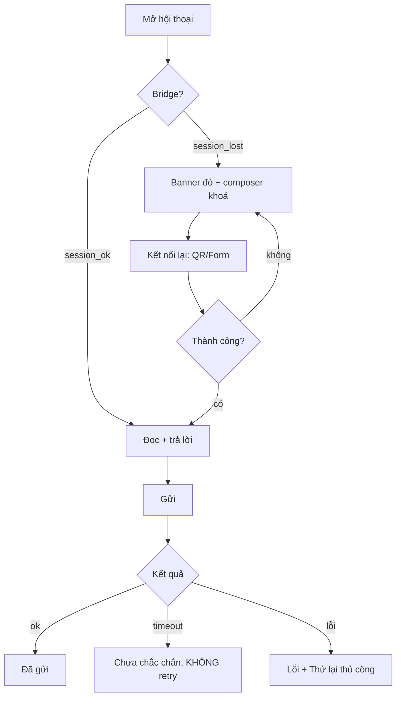

# Đặc tả UX/UI: Khung chat đa kênh tài khoản cá nhân

Trạng thái: đặc tả + wireframe, chưa có code, chưa tạo ảnh mockup (không có công cụ). Chưa chạy `design:lint` (file này không phải `DESIGN.md`).

## 0. Nguồn chuẩn, phạm vi, giả định

**Nguồn đã đọc**
- Plan: `docs/plans/personal-channels-20261027.json` (R1-R6, AC-1..7, businessRules).
- `docs/design/DESIGN.md` của repo này: hệ **Lumina CMS (React/Inertia, Instrument Sans, radius 4px, primary #2F6FED)**. Đây KHÔNG phải hệ của UI chat thực tế.
- Repo jam-easychatgpt-backend (Vue, chỉ đọc, dùng làm tham chiếu hành vi): `Conversation/ConversationSidebarLeft|Item|ChatArea|ChatInput|SidebarRight|Info|Avatar`, `ConversationZaloPersonal*`, `Settings/ChannelZaloPersonal.vue`.

**Quyết định nguồn chuẩn (đã duyệt, thay thế quyết định cũ "làm ở repo jam"):** UI chat triển khai **trong repo này** (React 19 + Inertia 3), dùng component admin Lumina và token `DESIGN.md` (Instrument Sans, radius 4px, primary #2F6FED), khớp roadmap M5. Tài liệu này **chỉ giữ phần hành vi**: 6 loại người gửi, trạng thái gửi, luồng session_lost, live mode, bố cục 3 cột, degrade theo kênh, accessibility. Mọi tên class Tailwind, component Vue và store Pinia nhắc bên dưới là **tham chiếu pattern từ jam, không dùng lại**; hình thức lấy từ `docs/design/mockups/chat-demo*.html`/`.png` và component Lumina. Phạm vi kênh đợt đầu: Telegram, Discord, Zalo, WhatsApp cá nhân (D2); Instagram và Messenger để đợt sau.

**0.1 Pattern jam đã quan sát (chỉ tham chiếu hành vi, không sao chép mã hay class)**
- Item hội thoại: `ConversationItem.vue` (avatar `relative`, tên `truncate`, tag nhỏ `bg-blue-100 text-blue-700 text-xs rounded-sm`, chip cảnh báo `bg-red-100 text-red-500`, preview `text-sm line-clamp-1`, badge chưa đọc tròn).
- Cảnh báo cấu hình: hộp `rounded-lg border border-amber-200 bg-amber-50 text-amber-900`, `role="status"`.
- Lỗi: `bg-destructive/10 text-destructive`. Thẻ: `rounded-xl border bg-white shadow-sm`. Nút icon `size="icon" w-8 h-8`, `Tooltip`, `Sheet` (panel phải/chi tiết), `Badge`, toast `vue-sonner`.
- Zalo Personal: badge kết nối + CTA "Kết nối lại" (QR) khi `session_lost`; `is_live_mode` mặc định `true`; màu Zalo `#0068FF`.
- Polling bằng `useIntervalFn` (vueuse); trạng thái ở store Pinia (`sourceEntities`).

**Giả định**
- Khung chat 3 cột hiện có (`SidebarLeft` / `ChatArea` / `SidebarRight`) được **mở rộng**, không dựng khung mới. Hội thoại kênh cá nhân dùng chung khung, chỉ thêm biến thể.
- Một workspace có thể có nhiều tài khoản cùng nền tảng (câu hỏi mở 2) nên UI luôn hiển thị tên tài khoản bên cạnh badge kênh.
- Phần Settings (QR dialog dùng lại, form Instagram username/password + 2FA) nằm ở plan P1/P2, chỉ nhắc lại ở mức liên kết, không thiết kế lại ở đây.
- Chủ sở hữu/agent dùng khung chat trên trình duyệt; quyền chỉnh bot theo quyền sẵn có (`canEdit`), backend vẫn là nơi kiểm quyền.

## 1. Người dùng và luồng chính

**Người dùng:** (a) Chủ tài khoản/vận hành viên xem và trả lời tay; (b) Quản trị workspace bật/tắt bot, live mode, kết nối lại session.

**Mô hình người gửi (6 loại, phải phân biệt được không chỉ bằng màu):**

| Loại | Nguồn | Hiển thị |
|---|---|---|
| Khách | tin inbound | bong bóng trái, nền trung tính |
| Bot | agent tự trả lời | bong bóng phải, nhãn "Bot" + icon Bot |
| Nhân viên | trả lời từ khung chat này | bong bóng phải, nhãn tên nhân viên |
| Chủ tài khoản (thiết bị khác) | echo/`is_self` -> `ExternalAgentReply` | bong bóng phải, viền nét đứt, nhãn "Chủ TK (thiết bị khác)" + icon Smartphone; không kích hoạt bot (AC-2) |
| Hệ thống | session_lost, rate-limit, nhóm | dòng giữa, chữ nhỏ |

**Luồng A: Xem hội thoại.** Sidebar trái, lọc kênh/tài khoản, chọn hội thoại, đọc khung tin, panel phải xem thông tin. Mobile: danh sách -> chi tiết (1 màn mỗi lần).

**Luồng B: Trả lời tay.** Chọn hội thoại, gõ trong composer, Enter gửi, bong bóng "Đang gửi" -> "Đã gửi" | "Chưa chắc chắn" | "Lỗi". Nếu bot đang bật cho hội thoại này, composer hiện dải thông báo "Bot đang trả lời tự động" kèm nút "Tạm dừng bot cho hội thoại này" (chuyển thủ công; không thêm khái niệm mới ngoài `is_live_mode`/chế độ phản hồi sẵn có, xem câu hỏi mở 4).

**Luồng C: Bot / live mode.** Công tắc `is_live_mode` ở panel phải (nhóm "Bot"). Tắt: bot ngừng trả lời, vẫn nhận tin; dải vàng "Live mode đang tắt, bot không trả lời" ở đầu khung tin.

**Luồng D: session_lost.** Bridge báo mất phiên -> kênh bị tắt (AC-5) -> trong khung chat: banner đỏ sticky đầu khung + composer `disabled` + CTA "Kết nối lại" (mở dialog QR cho WhatsApp/Zalo, form đăng nhập cho Instagram, cookie/AppState cho Messenger) -> thành công: banner biến mất, toast "Đã kết nối lại", composer bật.



## 2. Cấu trúc màn hình (desktop 3 cột)

### 2.1 Wireframe desktop

```
+--------------------+-----------------------------------------+---------------------+
| [Tìm kiếm...]  [≡] | (WA) Nguyễn An  · TK: +84 9xx (Shop A)  | Thông tin       [x] |
| Kênh: [Tất cả v]   |  [Live: BẬT]  [🔍] [ⓘ panel]            |---------------------|
| [Zalo][WA][IG][MS] |-----------------------------------------| Khách               |
| Trạng thái: [v]    | ! Mất phiên WhatsApp. [Kết nối lại]  <- | Nguyễn An (WA)      |
|--------------------|   (chỉ khi session_lost)                | +84 9xx ...         |
| (WA) Nguyễn An   2 |                                         |---------------------|
|  Dạ cho em hỏi...  |        ---- Hôm nay ----                | Tài khoản kết nối   |
|  10:42   [Bot]     |  [Khách]                                | (WA) Shop A         |
| (IG) shop_b        |  +------------------+                   | Bridge: ● Hoạt động |
|  Ảnh               |  | Cho em hỏi giá?  | 10:41             | Phiên: session_ok   |
|  09:10  ⚠ Mất phiên|  +------------------+                   | [Kết nối lại]       |
| (MS) Trần Bình     |              [Bot] +------------------+ |---------------------|
|  Đã gửi file       |                    | Dạ giá 200k ạ    | | Bot                 |
|  Hôm qua           |                    +------------------+ | Live mode  [==o]    |
| (ZL) Nhóm Bán hàng |                  10:41 ✓ Đã gửi        | Chế độ trả lời: ... |
|  @bot ơi...        |   [Chủ TK · thiết bị khác] - - - - - -+ |---------------------|
|  [@] Cần mention   |   | Để mình xử lý nhé |              | | Rủi ro ToS          |
|                    |   + - - - - - - - - - - +              | | ⚠ Tích hợp không    |
|                    |                                         | | chính thức...       |
|                    |-----------------------------------------| [Chi tiết]          |
| (cuộn vô hạn)      | [+] [😊] [ Nhập tin nhắn...        ] [➤]|                     |
+--------------------+-----------------------------------------+---------------------+
  ~320px                      linh hoạt (min 480)                    ~300px (đóng được)
```

### 2.2 Cột trái: danh sách hội thoại
- **Lọc kênh:** nhóm chip/segmented (tương tự `h-10 bg-gray-100 p-0.5` ở Settings Zalo): Tất cả, Zalo, WhatsApp, Instagram, Messenger. Chỉ hiện kênh đã bật theo workspace (Messenger mặc định tắt: ẩn chip cho tới khi bật). Có tài khoản nhiều: thêm `Select` "Tài khoản" khi >1 tài khoản của kênh đang chọn.
- **Lọc trạng thái:** Tất cả / Chưa đọc / Cần xử lý (lỗi gửi hoặc unknown) / Mất phiên. Bám `ConversationFilterMini`; không tạo bộ lọc riêng ngoài các mục này.
- **Item:** tái dùng `ConversationItem` thêm: (1) **badge kênh** ở góc avatar dưới phải (icon tròn 16px, màu thương hiệu + chữ tắt trong `aria-label`); (2) trạng thái: chấm/chip "Mất phiên" (đỏ + icon WifiOff), "Chưa chắc chắn" (amber + icon HelpCircle), icon Bot khi bot trả lời lần cuối, tiền tố "Bạn:"/"Bot:"/"Chủ TK:" trong preview; (3) nhóm: icon Users + chip "@ Cần mention" nếu có tin mention bot chưa xử lý.
- Màu thương hiệu kênh chỉ dùng cho huy hiệu nhỏ; **chữ/nền chính vẫn trung tính** để đảm bảo contrast. Zalo `#0068FF` (đã có trong repo); WhatsApp/Instagram/Messenger: dùng icon đơn sắc nền `muted`, không cần bắt chước màu logo (câu hỏi mở 6).

### 2.3 Cột giữa: khung tin nhắn
- Header: avatar + badge kênh, tên, tài khoản kết nối, chip Live mode, nút tìm (`ConversationThreadSearch`), nút bật/tắt panel phải.
- Dải trạng thái (sticky dưới header, tối đa 1 dải hiển thị, ưu tiên: session_lost > rate-limit > live tắt > ToS lần đầu).
- Danh sách tin: gom theo ngày, cuộn lên tải thêm; nút "Xuống tin mới" khi đang cuộn lên và có tin mới (`aria-live="polite"`).
- Composer (2.4).

### 2.4 Composer
- Thành phần: nút đính kèm (ảnh/video/file/audio, tuỳ kênh), emoji, textarea tự giãn (tối đa ~6 dòng), nút Gửi. Mở rộng `ConversationChatInput` (không viết lại).
- Khi đang trả lời quote: dải "Đang trả lời <tên>: <trích 1 dòng>" kèm nút X.
- Trạng thái composer: bình thường; `disabled` khi session_lost (placeholder "Mất phiên, kết nối lại để gửi"); `disabled` có đếm ngược khi rate-limit; bot-đang-bật: dải thông tin phía trên (không khoá, người vẫn gửi được).
- Enter gửi, Shift+Enter xuống dòng. Chống gửi đúp: nút Gửi khoá trong lúc đang gửi tin đó; **không auto-retry** khi unknown.
- Nhóm: composer cho phép gõ `@` mở danh sách thành viên (nếu kênh hỗ trợ mention, xem bảng 4).

### 2.5 Cột phải: panel thông tin (dùng `Sheet` ở mobile, cột cố định ở desktop)
Các nhóm, đóng/mở được (accordion):
1. **Khách:** tên, avatar, định danh kênh (SĐT/username/PSID rút gọn), nhãn, người phụ trách (tái dùng khối sẵn có của `ConversationSidebarRight`).
2. **Tài khoản kết nối:** tên, kênh, `personal_uid` rút gọn, bridge status: ● Hoạt động (session_ok) / ● Mất phiên (session_lost) / ● Đang kết nối; nút "Kết nối lại" (cần `canEdit`).
3. **Bot:** công tắc `is_live_mode` (có xác nhận khi tắt: "Bot sẽ ngừng trả lời mọi hội thoại của tài khoản này"? Xem câu hỏi mở 3), mô tả "Chỉ trả lời tin nhắn đến; nhóm chỉ trả lời khi được mention".
4. **Rủi ro ToS:** hộp amber (pattern `border-amber-200 bg-amber-50 text-amber-900`), mức rủi ro theo kênh (bảng 4), liên kết "Tìm hiểu".

## 3. Thành phần bong bóng

### 3.1 Cấu trúc chung
```
[avatar?] Tên người gửi · nhãn loại (Bot/Nhân viên/Chủ TK)
+---------------------------------+
| [quote]                         |
| nội dung                        |
| [media]                         |
+---------------------------------+
 [reaction chips]    10:41  ✓ Đã gửi
```
- Khách: trái; Bot/Nhân viên/Chủ TK: phải. Nhóm: hiển thị tên + avatar người gửi trên mỗi cụm tin liên tiếp.
- Cụm tin cùng người trong 2 phút: gộp, chỉ hiển thị tên/giờ ở cuối cụm.
- Giờ hiển thị `HH:mm`; hover/focus hiện đầy đủ ngày giờ qua `Tooltip` (`<time datetime>`).

### 3.2 Loại nội dung

| Loại | Hiển thị | Ghi chú |
|---|---|---|
| Text | Chữ, tự xuống dòng, link nhận diện | Giữ nguyên xuống dòng; `break-words` |
| Ảnh | Thumbnail tối đa ~240px, click mở lightbox | `alt` = tên file hoặc "Ảnh từ <tên>" |
| Video | Poster + nút play, thời lượng | Không autoplay |
| Audio/voice | Trình phát gọn, thời lượng | Có điều khiển bàn phím |
| File | Hàng icon + tên + dung lượng + tải về | |
| Media lỗi/hết hạn | Khung xám + icon ImageOff + "Không tải được" + nút "Thử lại" | Nền tảng thường hết hạn link |
| Quote | Khối thụt trái có vạch màu, tên + trích 2 dòng; click cuộn tới tin gốc; tin gốc không còn: "Tin nhắn gốc không khả dụng" | |
| Reaction | Chip emoji + số đếm dưới bong bóng; chip của mình có viền nhấn | `aria-label="Thả 👍, 3 người, bạn đã thả"` |
| Undo (thu hồi) | Thay nội dung bằng dòng nghiêng "Tin nhắn đã được thu hồi" + icon Undo2; ẩn media | Khách thu hồi: giữ dòng này; **không hiển thị lại nội dung cũ** mặc định (xem câu hỏi mở 5) |
| Mention (nhóm) | `@Tên` nền `accent`/`bg-blue-100 text-blue-700` (pattern tag hiện có); mention bot có thêm icon Bot và đánh dấu "Đã kích hoạt bot" ở dòng meta | Tin nhóm không mention: hiển thị bình thường, dòng meta "Không kích hoạt bot" (muted) |
| Hệ thống | Dòng giữa, chữ nhỏ muted | session_lost, kết nối lại, bot tạm dừng |

### 3.3 Trạng thái gửi (chỉ cho tin phía phải)

| Trạng thái | Icon + chữ (không chỉ màu) | Hành động |
|---|---|---|
| Đang gửi | Spinner nhỏ + "Đang gửi…" | Không thao tác |
| Đã gửi | Check + "Đã gửi" (chữ muted) | Menu tin nhắn: reply, react, thu hồi (nếu hỗ trợ) |
| Chưa chắc chắn (`unknown`, do timeout) | HelpCircle amber + "Chưa chắc chắn" | Tooltip: "Hết thời gian chờ, tin có thể đã gửi. Kiểm tra trên thiết bị rồi gửi lại nếu cần." Nút "Gửi lại" **thủ công**, kèm xác nhận ngắn "Có thể gửi trùng". Không retry tự động (AC-6) |
| Lỗi | AlertCircle đỏ + "Gửi lỗi" + lý do ngắn | Nút "Thử lại" (chắc chắn chưa gửi) và "Xoá" |

- Khi người dùng mở lại hội thoại, tin `unknown` vẫn giữ trạng thái đến khi có echo/receipt khớp (khi đó đổi sang "Đã gửi"); nếu không, giữ nguyên.
- Tin của khách, của chủ tài khoản từ thiết bị khác: không hiển thị trạng thái gửi.
- Menu tin nhắn (nút "..." hiện khi hover/focus, long-press ở mobile): Trả lời (quote), Thả cảm xúc, Thu hồi (chỉ tin do mình/bot gửi và kênh hỗ trợ), Sao chép. Các mục không hỗ trợ: ẩn, không để disabled khó hiểu (xem mục 4).

## 4. Khác biệt theo kênh và degrade

Dữ kiện tính năng thư viện (Baileys, instagrapi, fca-unofficial) **chưa kiểm chứng trong plan**, bảng dưới là **giả định thiết kế**; coder/architect xác nhận khi viết bridge và cập nhật bảng (nguồn chuẩn: bridge trả `capabilities` cho từng kết nối, câu hỏi mở 1).

| Khả năng | Zalo | WhatsApp | Instagram | Messenger |
|---|---|---|---|---|
| Text | Có | Có | Có | Có |
| Media (ảnh/video/file) | Có | Có | Ảnh/video; file hạn chế (giả định) | Có |
| Quote | Có | Có | Giả định hạn chế | Có |
| Reaction | Có | Có | Có (giả định) | Có |
| Undo/thu hồi | Có | Có | Có (giả định) | Có |
| Mention nhóm | Có | Có | Không có nhóm trong plan (giả định: chỉ DM) | Có |
| Realtime | Push | Push | **Poll** (trễ vài giây-chục giây) | Push (MQTT) |
| Rủi ro khoá TK (plan) | Đã dùng | Thấp | Trung bình | **Cao** |

**Cơ chế degrade (một nguồn: `capabilities` của kết nối):**
- Tính năng không hỗ trợ: **ẩn** mục trong menu/composer, không hiển thị nút vô hiệu mơ hồ. Chỉ trường hợp "hỗ trợ nhưng tạm thời không dùng được" mới `disabled` + tooltip lý do.
- Nhận tin có loại không hiển thị được (sticker lạ, tin tạm biến mất, cuộc gọi): bong bóng fallback "Loại tin chưa hỗ trợ: <loại>" + icon, không bỏ trống.
- Reaction/undo đến từ kênh nhưng UI không hỗ trợ kênh đó: vẫn render theo mục 3.2.
- Instagram poll: header hiện chip "Cập nhật định kỳ" (tooltip: "Tin mới có thể đến chậm"); không có chỉ báo "đang gõ".
- Ghi chú trễ: tránh hứa "gửi ngay" trên Instagram.

**Cảnh báo rủi ro ToS (businessRules: phải thông báo trước khi kết nối):**
- Mức 1, tại Settings khi kết nối (ngoài phạm vi file này nhưng là điều kiện): hộp amber + checkbox "Tôi hiểu rủi ro" bắt buộc.
- Mức 2, trong khung chat: mục "Rủi ro ToS" ở panel phải, mọi hội thoại; ngắn, không lặp lại trong từng tin.
- Mức 3: lần đầu mở một hội thoại kênh cá nhân trong phiên trình duyệt hiển thị dải amber đóng được (lưu cờ đã đóng theo kênh ở client). Messenger: dải luôn có chip "Rủi ro cao" cạnh badge kênh.
- Nội dung cảnh báo: câu hỏi mở 6 (chưa chốt). Văn bản gợi ý (cần duyệt): "Kênh này dùng kết nối không chính thức với tài khoản cá nhân, có thể vi phạm điều khoản nền tảng và dẫn đến khoá tài khoản."

## 5. Các trạng thái

| Trạng thái | Danh sách | Khung tin | Composer |
|---|---|---|---|
| Loading đầu | Skeleton 6 item | Skeleton bong bóng xen trái/phải | `disabled` |
| Loading thêm (cuộn lên) | Spinner cuối danh sách | Spinner đầu khung, giữ vị trí cuộn | Bình thường |
| Rỗng, chưa kết nối kênh nào | Hình + "Chưa kết nối tài khoản cá nhân" + nút "Kết nối kênh" (tới Settings, cần quyền) | - | - |
| Rỗng, không có hội thoại | "Chưa có hội thoại" | "Chọn một hội thoại" (cột giữa) | ẩn |
| Rỗng, lọc không ra | "Không tìm thấy" + nút "Xoá bộ lọc" | - | - |
| Hội thoại mới chưa có tin | - | "Chưa có tin nhắn. Bắt đầu bằng một lời chào"? chỉ khi kênh cho phép chủ động gửi (plan: chỉ trả lời inbound, xem câu hỏi mở 2) | Theo quy tắc |
| Offline trình duyệt | Dải xám "Mất mạng, đang thử lại" | Giữ dữ liệu cũ | `disabled`; tin gõ dở được giữ |
| **session_lost** | Chip "Mất phiên" đỏ ở item; filter "Mất phiên" | Banner đỏ sticky `role="alert"`: "Mất phiên <kênh> của <tài khoản>. Bot đã ngừng trả lời." + [Kết nối lại] | `disabled`; lịch sử vẫn đọc được |
| Bridge đang kết nối | Chip "Đang kết nối" | Dải xanh/`muted` `role="status"` | `disabled` ngắn |
| **Rate-limit** (bridge giới hạn tần suất, giảm rủi ro khoá) | - | Dải amber `role="status"`: "Đang giới hạn tốc độ gửi để bảo vệ tài khoản. Có thể gửi lại sau mm:ss." | Nút Gửi `disabled` + đếm ngược (cập nhật mỗi giây, `aria-live` chỉ thông báo khi bắt đầu/kết thúc, không đọc từng giây) |
| Kênh bị tắt theo workspace | Ẩn chip kênh | Hội thoại cũ chỉ đọc, dải "Kênh đã tắt" | `disabled` |
| Thiếu quyền | - | Ẩn "Kết nối lại", công tắc live mode `disabled` + tooltip "Cần quyền quản trị" | Theo quyền trả lời sẵn có |
| Lỗi tải | "Không tải được" + [Thử lại] | tương tự | - |

Ưu tiên hiển thị 1 dải ở đầu khung: session_lost > kênh tắt > rate-limit > live tắt > ToS lần đầu (các dải còn lại gộp vào panel phải).

## 6. Responsive, accessibility, animation

### 6.1 Responsive

| Breakpoint | Bố cục |
|---|---|
| >= 1280px (xl) | 3 cột: ~320 / linh hoạt / ~300 |
| 1024-1279 (lg) | 2 cột (danh sách + khung), panel phải là `Sheet` mở từ nút ⓘ |
| < 1024 (mobile/tablet dọc) | 1 màn mỗi lần: Danh sách -> Khung chat (nút Back) -> Panel (Sheet toàn chiều cao) |

Mobile: header khung chat gọn (Back, avatar+badge, tên, tài khoản dưới tên, nút ⓘ); chip kênh cuộn ngang; vùng chạm >= 40px (khuyến nghị 44px) cho component mới; bong bóng tối đa ~80% chiều rộng; composer dính đáy, nhớ `safe-area-inset-bottom` và bàn phím ảo không che composer; hành động tin nhắn bằng long-press mở bottom sheet; không cuộn ngang ở 320px.

```
Mobile: Danh sách           Mobile: Chat                 Mobile: Panel (Sheet)
+------------------+  +------------------------+   +------------------------+
| [Tìm...]    [≡]  |  | <  (WA) Nguyễn An  [ⓘ] |   | Thông tin          [x] |
| [Tất cả|ZL|WA|IG>|  |    Shop A · Live BẬT    |   | Khách ...              |
|------------------|  |------------------------|   | Tài khoản kết nối      |
| (WA) Nguyễn An 2 |  | ! Mất phiên [Kết nối]  |   |  Bridge ● Mất phiên    |
|  Dạ cho em...    |  |   ---- Hôm nay ----    |   |  [Kết nối lại]         |
| (IG) shop_b  ⚠   |  | [Khách] Cho em hỏi giá |   | Bot  Live mode [==o]   |
| (MS) Trần Bình   |  |        [Bot] Dạ 200k ✓ |   | Rủi ro ToS (amber)     |
| (ZL) Nhóm   [@]  |  | [Chủ TK] Để mình ...   |   +------------------------+
|                  |  |------------------------|
|                  |  | [+] [Nhập tin nhắn..][➤]|
+------------------+  +------------------------+
```

### 6.2 Accessibility
- Landmarks: danh sách `nav`/`role="list"` có `aria-label="Danh sách hội thoại"`; khung tin `role="log"` + `aria-live="polite"` + `aria-relevant="additions"`; không đọc lại toàn bộ khi tải lịch sử cũ (tạm gỡ live khi prepend).
- Item hội thoại: là `button`/link duy nhất, `aria-current="true"` khi chọn; `aria-label` tổng hợp: "WhatsApp, Nguyễn An, 2 tin chưa đọc, mất phiên, 10:42".
- Badge kênh: `aria-label`/chữ ẩn thị giác (sr-only) ghi tên kênh; không dựa màu.
- Bong bóng: tên người gửi + loại gửi (Khách/Bot/Nhân viên/Chủ TK) có chữ sr-only; trạng thái gửi là chữ, không chỉ icon; `unknown` và lỗi `aria-live="polite"` khi đổi trạng thái.
- Menu tin: nút "..." focus được, `aria-haspopup="menu"`; phím tắt tối thiểu: Tab/Shift+Tab, Enter gửi, Esc đóng menu/dialog/hủy quote, mũi tên trong menu.
- Dialog/Sheet: bẫy focus, Esc đóng, trả focus về nút kích hoạt (Radix/shadcn-vue đã có). Xác nhận gửi lại unknown dùng `AlertDialog`.
- Focus ring nhìn rõ cho mọi control (kế thừa ring của jam). Banner `session_lost` dùng `role="alert"` (chỉ 1 lần khi xuất hiện), các dải khác `role="status"`.
- Contrast: chữ >= 4.5:1. Text muted trên nền sáng và chữ trên màu thương hiệu kênh cần QA đo (chưa đo). Cảnh báo amber: dùng `amber-900` trên `amber-50` (pattern đã có). Chữ đỏ nhỏ: dùng `foreground` + icon đỏ nếu không đạt.
- Reaction chip, nút icon: có nhãn text; mục tiêu chạm >= 24px (WCAG 2.2), khuyến nghị 40px mobile.
- Ảnh trong tin: `alt`; lightbox có nút đóng và điều hướng bàn phím.

### 6.3 Animation (tối giản)
- Chỉ: bong bóng mới fade/slide-in ngắn (<= 150ms), chuyển trạng thái gửi (đổi icon, không nhảy bố cục), Sheet/Back trượt chuẩn của thư viện.
- Spinner "Đang gửi"/đang kết nối là chuyển động duy nhất liên tục, thay bằng chữ tĩnh khi reduced-motion.
- `prefers-reduced-motion`: tắt slide/fade (dùng `motion-reduce:transition-none`, `motion-reduce:animate-none`), cuộn tới tin mới dùng `behavior: auto`.
- Không dùng hiệu ứng nhấp nháy để thu hút cảnh báo.

## 7. Tiêu chí nghiệm thu (liên kết plan)

1. Danh sách lọc được theo kênh, mỗi item có badge kênh + tên tài khoản (R1).
2. Tin Chủ TK từ thiết bị khác hiển thị đúng loại, khác với tin Bot/Nhân viên, và UI không báo "bot đang trả lời" cho tin đó (AC-2).
3. Tin nhóm chỉ đánh dấu "Đã kích hoạt bot" khi có mention bot (AC-3).
4. session_lost: banner + composer khoá + CTA kết nối lại; kết nối lại xong thì bình thường (AC-5).
5. Timeout gửi hiển thị "Chưa chắc chắn", không có thử lại tự động, gửi lại thủ công có cảnh báo trùng (AC-6).
6. Menu tin nhắn chỉ hiện reaction/undo/quote khi kênh hỗ trợ.
7. Cảnh báo ToS có ở panel phải và ở bước kết nối; Messenger có chip rủi ro cao.
8. Rate-limit: gửi khoá và có đếm ngược, không mất bản nháp.
9. Dùng được bằng bàn phím, 320px không cuộn ngang, reduced-motion không có chuyển động liên tục.
10. Không hiển thị credential/cookie/secret trong UI (AC-7).

## 8. Câu hỏi mở

1. Bridge có trả `capabilities` theo kết nối cho UI không? Bảng mục 4 mới là giả định thiết kế, cần xác nhận thực tế từng thư viện.
2. Có cho gửi tin chủ động tạo hội thoại mới không? Plan nói "chỉ trả lời inbound" và loại trừ gửi hàng loạt; thiết kế giả định **không** có nút "Tin nhắn mới" cho kênh cá nhân.
3. Tắt `is_live_mode` có cần xác nhận không, và phạm vi: theo tài khoản (giả định) hay theo từng hội thoại?
4. Có cần "tạm dừng bot cho từng hội thoại"? Mục 2.1/Luồng B giả định dùng chế độ phản hồi hiện có của jam (`ConversationFilterResponseMode`); nếu chưa có thì bỏ nút này.
5. Khi khách thu hồi tin, có lưu/hiện lại nội dung gốc cho nhân viên không (vấn đề quyền riêng tư)? Mặc định thiết kế: không hiện.
6. Nội dung cảnh báo ToS và màu/logo từng kênh (xem 0.1, 2.2, 4): cần duyệt. Plan cũng nêu câu hỏi này.
7. Nhiều tài khoản cùng nền tảng trong workspace (plan nêu): nếu có, bộ lọc "Tài khoản" ở 2.2 là bắt buộc; nếu không, bỏ.
8. Ngưỡng/hiển thị rate-limit: bridge có trả thời gian chờ còn lại để đếm ngược không?

## 9. Bàn giao

- Dựng mới trong repo này (React, `resources/js/`) theo cấu trúc jam làm tham chiếu: danh sách hội thoại, item, khung chat, composer, panel phải, tìm trong hội thoại, bộ lọc, avatar, dialog QR. Dùng lại `IndexLayout`, `Badge`, `useConfirm`, `Sheet`, `Tooltip` của Lumina nếu đã có.
- Component mới nhỏ gợi ý: `ChannelBadge`, `MessageSendStatus`, `SenderLabel`, `ConversationStatusBanner`, `PersonalAccountPanel`. Đặt tên/đường dẫn theo quy ước `resources/js/components` của repo này; không thêm route ngoài plan.
- Backend cần cung cấp cho UI (đề xuất, ngoài phạm vi thiết kế): loại người gửi (`customer|bot|agent|external_agent`), `send_status` (`sending|sent|unknown|failed`), `bridge_status`, `is_live_mode`, `capabilities`, `rate_limit_until`.
